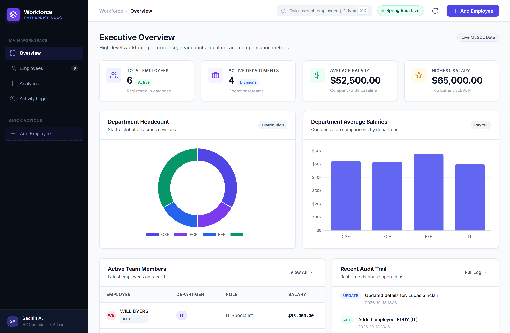
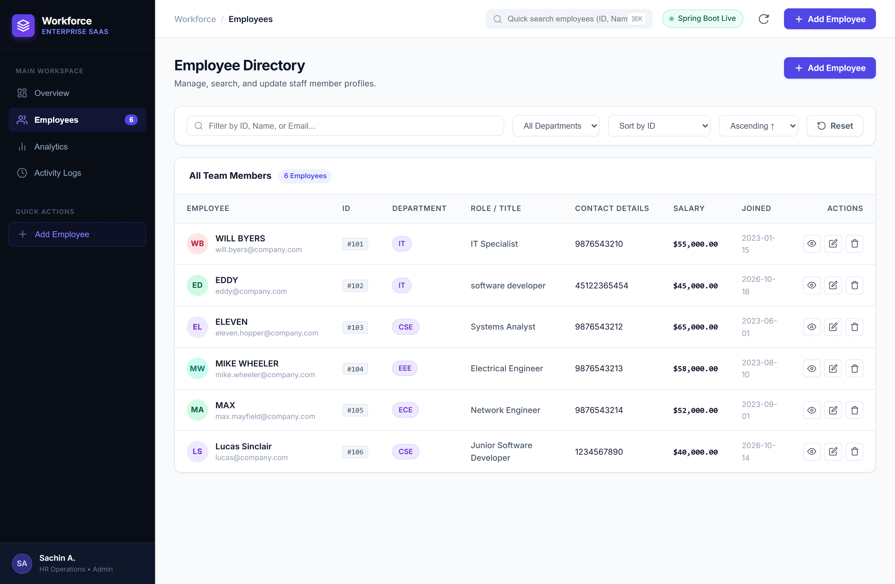
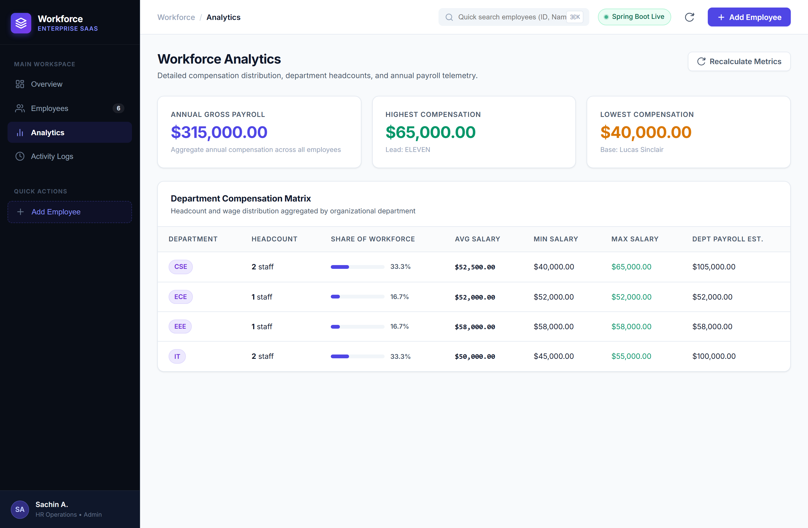
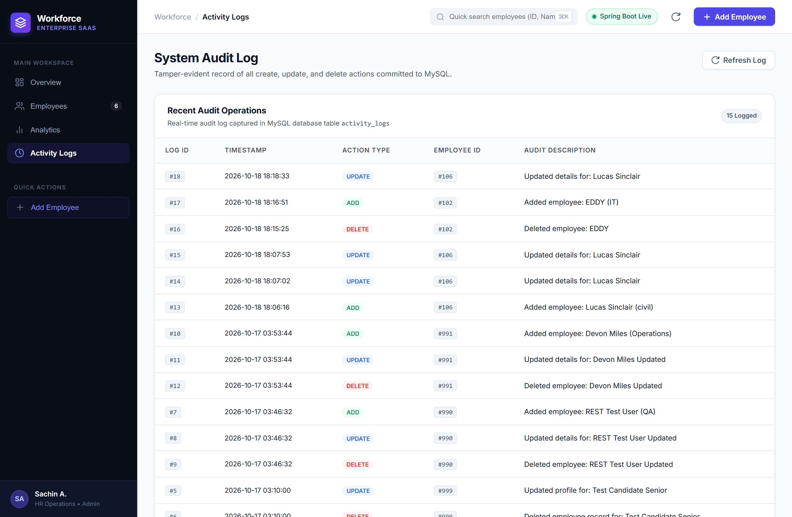
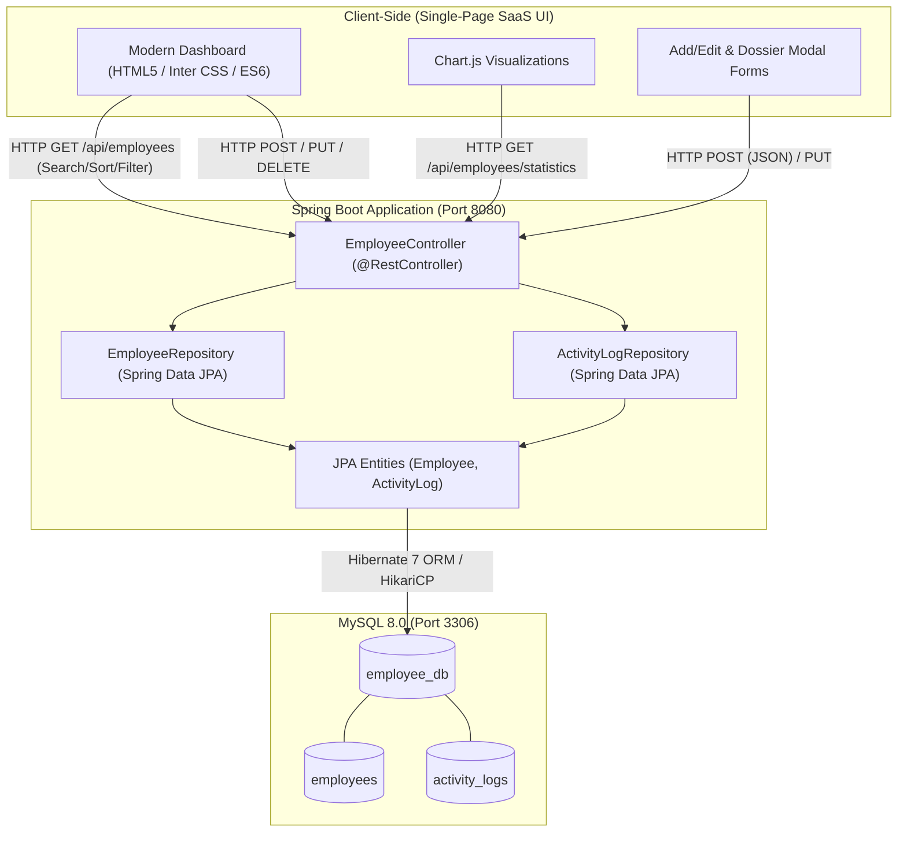

# Workforce — Employee Management System

[](https://www.oracle.com/java/)
[](https://spring.io/projects/spring-boot)
[](https://spring.io/projects/spring-data-jpa)
[](https://www.mysql.com/)
[](https://www.chartjs.org/)
[](LICENSE)

An enterprise-grade, modern SaaS workforce management web application engineered with **Spring Boot 4**, **Spring Data JPA**, **MySQL**, and a responsive **Linear/Stripe-inspired dashboard frontend**. 

Workforce delivers end-to-end human resource operations: real-time executive KPI metrics, interactive data visualisations, dynamic multi-attribute employee directory search and filtering, modal dossier inspection, full CRUD lifecycle controls with duplicate validation, payroll analytics, and a tamper-evident database audit trail.

---

## Table of Contents

- [Problem Statement & Solution](#problem-statement--solution)
- [Key Features](#key-features)
- [Visual Showcase (Screenshots)](#visual-showcase-screenshots)
- [System Architecture & Request Flow](#system-architecture--request-flow)
- [Technology Stack](#technology-stack)
- [Prerequisites](#prerequisites)
- [Database Setup & Schema](#database-setup--schema)
- [Environment Configuration](#environment-configuration)
- [How to Run the Application](#how-to-run-the-application)
- [REST API Documentation](#rest-api-documentation)
- [Testing & Verification](#testing--verification)
- [Known Limitations & Future Roadmap](#known-limitations--future-roadmap)

---

## Problem Statement & Solution

Traditional workforce management systems in small-to-medium enterprises often suffer from:
1. **Scattered Data Silos**: Employee records maintained across legacy spreadsheets or terminal tools lack data integrity constraints and audit tracking.
2. **Poor User Experience**: Clunky forms, absence of real-time search, and lack of visual analytics make workforce insights difficult to extract.
3. **Absence of Accountability**: Personnel edits, salary adjustments, and deletions occur without automated audit logging.

**Workforce** resolves these issues by pairing a robust Spring Boot REST backend with a reactive, single-page enterprise dashboard:
- **Centralized MySQL Storage**: Strict relational modeling with entity validation (positive salaries, valid emails, unique IDs).
- **Executive Telemetry**: Instant KPI cards and Chart.js visualizations calculate workforce distribution and salary baselines on the fly.
- **Automated Audit Logging**: Every `ADD`, `UPDATE`, and `DELETE` operation writes directly to a persistent `activity_logs` table with exact timestamps.

---

## Key Features

### 1. Executive Overview Dashboard
- **4 Real-Time KPI Cards**: Total Employees, Active Departments, Average Salary, and Top Compensation with leading earner highlight.
- **Interactive Visualizations (Chart.js)**:
  - *Department Headcount Distribution* (Doughnut Chart).
  - *Department Average Compensation* (Bar Chart).
  - Automatic graceful fallback progress bars if external CDN access is restricted.
- **Active Team Members Feed**: Quick-view table of recent personnel additions.
- **Recent Audit Trail**: Live snapshot of the latest database operations.

### 2. Comprehensive Employee Directory
- **8 Core Employee Attributes**: ID, Full Name, Department, Job Title, Email Address, Phone Number, Salary, and Joining Date.
- **Initials Avatars**: Procedurally generated, color-coded avatar badges based on employee names.
- **Unified Real-Time Search**: Search instantly by Employee ID, Full Name, or Email Address.
- **Department Filtering**: Filter records across all registered organizational departments.
- **Multi-Field Sorting**: Dynamically sort records by ID, Name, Department, Salary, or Joining Date in Ascending or Descending order.
- **Quick Action Triggers**:
  - **View Dossier**: Inspect a clean modal profile card containing complete personnel contact and compensation data.
  - **Edit Profile**: Pre-populates the modal form with existing data for seamless updates.
  - **Delete Record**: Interactive confirmation dialog with instant UI update and audit logging.

### 3. Add & Edit Employee Experience
- **Slide-Up Modal Dialog**: Responsive two-column form layout.
- **Robust Field Validation**:
  - Unique positive integer Employee ID (locked during updates).
  - Required Full Name and Department with autocomplete datalist.
  - Email format verification (regex validation on client and unique constraint on server).
  - Currency input formatting with positive salary enforcement.
- **State Feedback**: Submission button transitions to `"Saving..."` to prevent duplicate clicks; floating toast notifications report success or error details.

### 4. Workforce Analytics & Payroll Telemetry
- **Top Financial Indicators**: Aggregate Annual Gross Payroll (`avgSalary * totalCount`), Company Average Salary, and Salary Extremes (Highest vs. Lowest Earner).
- **Department Compensation Matrix**: Detailed table displaying department headcount, percentage share of total workforce with visual progress bars, average wage, minimum wage, maximum wage, and estimated departmental payroll.

### 5. Persistent System Audit Trail
- Automated logging of every mutating operation (`ADD`, `UPDATE`, `DELETE`).
- Color-coded action pills (`ADD`: Emerald, `UPDATE`: Blue, `DELETE`: Rose).
- Captures Log ID, Timestamp, Action Type, Target Employee ID, and Detailed Operation Description.

---

## Visual Showcase (Screenshots)

### 1. Executive Overview Dashboard
*High-level workforce performance, headcount allocation, live Chart.js visualizations, and recent activity.*


### 2. Employee Directory
*Searchable, filterable workforce roster featuring initials avatars, department badges, formatted compensation, and row action triggers.*


### 3. Workforce Analytics
*Department compensation matrix, payroll telemetry, and workforce share distribution.*


### 4. System Audit Log
*Tamper-evident, chronological record of all create, update, and delete actions committed to MySQL.*


---

## System Architecture & Request Flow



### Request Flow Lifecycle
1. **Client Request**: Browser dispatches asynchronous `fetch()` requests to `/api/employees/*` endpoints.
2. **Controller Layer**: [`EmployeeController`](src/main/java/com/example/employee/EmployeeController.java) receives requests, performs input sanity checks, validates against duplicate IDs/emails, and executes business logic.
3. **Data Access Layer**: [`EmployeeRepository`](src/main/java/com/example/employee/EmployeeRepository.java) leverages Spring Data JPA and Hibernate ORM to translate operations into optimized SQL queries.
4. **Audit Interception**: On every create, update, or delete action, an [`ActivityLog`](src/main/java/com/example/employee/ActivityLog.java) entity is constructed and saved into `activity_logs`.
5. **JSON Response**: Clean DTO/Entity JSON payloads are returned with appropriate HTTP status codes (`200 OK`, `201 Created`, `204 No Content`, `400 Bad Request`, `404 Not Found`, `409 Conflict`).

---

## Technology Stack

| Layer | Technology | Details |
| :--- | :--- | :--- |
| **Backend Framework** | Spring Boot 4.1.1 | Spring WebMVC, Spring Data JPA |
| **Language & Runtime** | Java 17 | JDK 17 (LTS), Modern Records & Streams |
| **ORM & Persistence** | Hibernate 7.4.5, HikariCP | Connection pooling, schema migration |
| **Database** | MySQL 8.0+ | Relational storage (`employees`, `activity_logs`) |
| **Frontend Architecture**| Vanilla ES6+ JavaScript | Async/Await, Fetch API, DOM manipulation |
| **Styling & Design** | CSS3 Custom Properties | Deep navy theme (`#090d16`), Inter typography, CSS Grid/Flexbox |
| **Data Visualization** | Chart.js 4.4.1 | Responsive Doughnut & Bar charts |
| **Build Tool** | Apache Maven 3.9+ | Wrapper included (`mvnw`, `mvnw.cmd`) |

---

## Prerequisites

Before setting up the project locally on Windows, ensure the following software is installed:

1. **Java Development Kit (JDK) 17**:
   - Verify installation:
     ```powershell
     java -version
     ```
2. **MySQL Server 8.0+**:
   - Ensure the MySQL service is running on default port `3306`.
3. **Web Browser**:
   - Google Chrome, Microsoft Edge, or Mozilla Firefox.

---

## Database Setup & Schema

1. Log into your MySQL instance via MySQL Command Line Client or MySQL Workbench:
   ```sql
   mysql -u root -p
   ```

2. Create the application database:
   ```sql
   CREATE DATABASE IF NOT EXISTS employee_db;
   USE employee_db;
   ```

3. Table definitions (auto-managed by Hibernate `spring.jpa.hibernate.ddl-auto=update`):

```sql
-- Employees Table
CREATE TABLE IF NOT EXISTS employees (
    id INT PRIMARY KEY,
    name VARCHAR(255) NOT NULL,
    department VARCHAR(255) NOT NULL,
    job_title VARCHAR(255),
    email VARCHAR(255),
    phone VARCHAR(255),
    salary DOUBLE NOT NULL,
    joining_date VARCHAR(255)
);

-- Audit History Table
CREATE TABLE IF NOT EXISTS activity_logs (
    id INT AUTO-INCREMENT PRIMARY KEY,
    timestamp DATETIME NOT NULL,
    action VARCHAR(50) NOT NULL,
    employee_id INT,
    details VARCHAR(500) NOT NULL
);
```

4. Baseline Sample Records (Optional):
```sql
INSERT INTO employees (id, name, department, job_title, email, phone, salary, joining_date) VALUES
(101, 'WILL BYERS', 'IT', 'IT Specialist', 'will.byers@company.com', '9876543210', 55000.0, '2023-01-15'),
(102, 'EDDY', 'IT', 'Software Developer', 'eddy@company.com', '45122365454', 45000.0, '2026-10-18'),
(103, 'ELEVEN', 'CSE', 'Systems Analyst', 'eleven.hopper@company.com', '9876543212', 65000.0, '2023-06-01'),
(104, 'MIKE WHEELER', 'EEE', 'Electrical Engineer', 'mike.wheeler@company.com', '9876543213', 58000.0, '2023-08-10'),
(105, 'MAX', 'ECE', 'Network Engineer', 'max.mayfield@company.com', '9876543214', 52000.0, '2023-09-01');
```

---

## Environment Configuration

To keep database credentials secure without hardcoding secrets into source control, configure your credentials using environment variables.

In `src/main/resources/application.properties`:

```properties
spring.application.name=employee-management

# Database Configuration with Environment Variable Fallbacks
spring.datasource.url=${DB_URL:jdbc:mysql://localhost:3306/employee_db}
spring.datasource.username=${DB_USER:root}
spring.datasource.password=${DB_PASSWORD}

spring.datasource.driver-class-name=com.mysql.cj.jdbc.Driver

# Hibernate & JPA Properties
spring.jpa.hibernate.ddl-auto=update
spring.jpa.show-sql=false
spring.jpa.database-platform=org.hibernate.dialect.MySQLDialect
```

### Setting Environment Variables on Windows

**In PowerShell (Current Session):**
```powershell
$env:DB_USER = "root"
$env:DB_PASSWORD = "YourSecurePassword"
```

**In Command Prompt (Current Session):**
```cmd
set DB_USER=root
set DB_PASSWORD=YourSecurePassword
```

**Persistently in Windows:**
1. Open Windows Search and type **Environment Variables**.
2. Click **Edit the system environment variables** &rarr; **Environment Variables...**.
3. Under *User variables*, add `DB_USER` and `DB_PASSWORD`.

---

## How to Run the Application

Navigate to the project root directory:
```powershell
cd C:\Users\sachi\Downloads\employee-management\employee-management
```

### Method 1: Using Maven Wrapper (Command Line)

1. Build and package the application:
   ```powershell
   .\mvnw.cmd clean package -DskipTests
   ```
2. Start the Spring Boot application:
   ```powershell
   .\mvnw.cmd spring-boot:run
   ```
   *Or run the standalone JAR directly:*
   ```powershell
   java -jar target/employee-management-0.0.1-SNAPSHOT.jar
   ```

### Method 2: Running in Eclipse IDE / Spring Tool Suite (STS)

1. Open Eclipse and select your workspace.
2. Select **File** &rarr; **Import...** &rarr; **Existing Maven Projects** &rarr; Browse to the project folder &rarr; Click **Finish**.
3. Right-click the project root in **Project Explorer** and select **Refresh** (`F5`).
4. Navigate to `src/main/java` &rarr; `com.example.employee` &rarr; right-click `EmployeeManagementApplication.java`.
5. Select **Run As** &rarr; **Spring Boot App** (or **Java Application**).

### Accessing the Web Dashboard

Once Tomcat initializes on port `8080`, open your browser:
```
http://localhost:8080/
```
*(Tip: Press `Ctrl + F5` to perform a hard refresh and load the latest CSS and scripts.)*

---

## REST API Documentation

All endpoints communicate using JSON over HTTP under the `/api/employees` namespace.

| Method | Endpoint | Description | Request Body | Query Parameters | Status Codes |
| :--- | :--- | :--- | :--- | :--- | :--- |
| `GET` | `/api/employees` | Retrieve employee roster with optional search, department filter, and dynamic sorting | None | `search`, `department`, `sortBy`, `order` | `200 OK` |
| `GET` | `/api/employees/{id}` | Retrieve details of a specific employee | None | None | `200 OK`, `404 Not Found` |
| `POST` | `/api/employees` | Register a new employee and log `ADD` action | `Employee` JSON | None | `201 Created`, `400 Bad Request`, `409 Conflict` |
| `PUT` | `/api/employees/{id}` | Update existing employee details and log `UPDATE` action | `Employee` JSON | None | `200 OK`, `400 Bad Request`, `404 Not Found`, `409 Conflict` |
| `DELETE` | `/api/employees/{id}` | Permanently delete an employee and log `DELETE` action | None | None | `204 No Content`, `404 Not Found` |
| `GET` | `/api/employees/statistics` | Aggregate workforce KPI metrics and departmental compensation breakdown | None | None | `200 OK` |
| `GET` | `/api/employees/departments` | Retrieve list of all unique active department names | None | None | `200 OK` |
| `GET` | `/api/employees/activity-logs` | Retrieve the 15 most recent system audit log entries | None | None | `200 OK` |

### Sample `POST /api/employees` Payload

```json
{
  "id": 107,
  "name": "Nancy Wheeler",
  "department": "IT",
  "jobTitle": "Security Engineer",
  "email": "nancy.wheeler@company.com",
  "phone": "9876543215",
  "salary": 68000.0,
  "joiningDate": "2024-01-10"
}
```

---

## Testing & Verification

### Automated Backend Build
Run Maven compile and test tasks:
```powershell
.\mvnw.cmd test-compile
```

### Manual API Smoke Tests (PowerShell / cURL)

1. **Verify Health & Fetch Employees**:
   ```powershell
   curl -s http://localhost:8080/api/employees
   ```
2. **Search by Email or Name**:
   ```powershell
   curl -s "http://localhost:8080/api/employees?search=hopper"
   ```
3. **Filter by Department & Sort by Salary**:
   ```powershell
   curl -s "http://localhost:8080/api/employees?department=CSE&sortBy=salary&order=desc"
   ```
4. **Query Analytics Telemetry**:
   ```powershell
   curl -s http://localhost:8080/api/employees/statistics
   ```
5. **View Recent Audit Logs**:
   ```powershell
   curl -s http://localhost:8080/api/employees/activity-logs
   ```

---

## Known Limitations & Future Roadmap

- **Authentication & RBAC**: Currently operates in administrative intranet mode. A planned enhancement is integration of Spring Security 6 with JWT tokens and role-based permissions (Admin, HR Manager, Viewer).
- **Pagination**: The directory dynamically renders all current records efficiently. For enterprise organizations exceeding 1,000 employees, server-side pagination using Spring Data `Pageable` will be implemented.
- **Exporting Capabilities**: Future releases will introduce one-click CSV and PDF workforce payroll exports.

---

## License

This project is open-source under the [MIT License](LICENSE).
